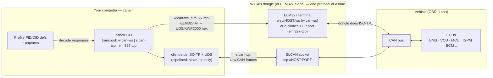
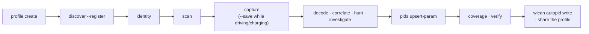

# canair

**CLI for reverse engineering CAN/OBD diagnostics over the air with a WiCAN dongle**

[](https://philipkocanda.github.io/canair/)
[](https://github.com/philipkocanda/canair/actions/workflows/ci.yml)
[](LICENSE)


canair is a command-line tool (CLI). It connects to a
[WiCAN](https://www.meatpi.com/products/wican-pro) OBD-II (On-Board Diagnostics) WiFi dongle. It
works with the data of a vehicle in **two domains**:

- **Diagnostics.** canair sends requests to the electronic control units (ECUs) of the car and
  reads the responses. It uses the UDS (Unified Diagnostic Services) and KWP2000 (Keyword
  Protocol 2000) protocols.
- **Raw broadcast CAN.** The car sends these Controller Area Network (CAN) frames on its own.
  canair listens passively, or imports frames from external logs and DBC (CAN database) files.

canair also has a set of analysis commands. They capture data, decode it, find statistical
correlations, and show which byte carries which signal. You can then turn the results into a
[WiCAN vehicle profile](https://meatpihq.github.io/wican-fw/config/automate/new_vehicle_profiles)
or into documentation that you can share.

The CLI is one command: **`canair`**. Vehicle data lives in a *profile* bundle. The repository
has several profiles in [`profiles/`](profiles/). The 2017 Hyundai Ioniq Electric is the most
complete one. The tool works with any vehicle, so you can
[build a profile for your car](https://philipkocanda.github.io/canair/bring-your-own-car/overview/).

## Why canair?

- **Evidence stays with the definition.** Most tools store only the PID, DID and signal
  definitions. canair also stores the captures that support each definition. Anyone can check a
  definition against the data, and the community can decode together. A definition without proof
  has little worth.
- **Two kinds of data in one profile.** canair combines request/response diagnostics (OBD-II,
  UDS, KWP2000) with raw broadcast CAN frames (for example from DBC files). Both kinds use the
  same profile and the same analysis tools. What you know about a signal in one kind of data helps
  you find the same signal in the other.
- **Made for humans and agents.** Helpers import and analyze both kinds of captures. Every
  capability is a subcommand that you can script, with structured output (`--json`). A person or
  an AI coding agent can use it in the same way. The reverse-engineering workflows are available
  as agent skills in `.claude/skills/`.
- **Shareable without copied definitions.** Profiles come from captures of real cars. They do not
  copy the definitions of a dealer scan tool. People can share them without copying the content of
  a vendor tool. This opens vehicle maintenance and diagnostics to a wider community.

**The WiCAN Pro and the classic WiCAN both work** with the default raw-SLCAN transport. Some
features need a Pro: AutoPID device sync, `wican mode set` and the `wican-ws` transport. If you
set `wican_model: classic`, canair refuses these features with a clear message. See
[connect your dongle](https://philipkocanda.github.io/canair/getting-started/connect-device/).

**canair supports WiCAN firmware 4.x.** On the firmware v6 rewrite, only the `elm327-tcp`
transport works today. See
[firmware compatibility](https://philipkocanda.github.io/canair/getting-started/connect-device/#firmware-compatibility).

> **Documentation:** **[philipkocanda.github.io/canair](https://philipkocanda.github.io/canair/)** —
> [Getting started](https://philipkocanda.github.io/canair/getting-started/install/) ·
> [**Bring your own car**](https://philipkocanda.github.io/canair/bring-your-own-car/overview/)
> (the full walkthrough for a new vehicle) ·
> [**Profile explorer**](https://philipkocanda.github.io/canair/profiles/explorer/) (browse and
> plot real Ioniq data in your browser) ·
> [Concepts](https://philipkocanda.github.io/canair/concepts/architecture/) ·
> [Reference](https://philipkocanda.github.io/canair/reference/config/). The source is in
> [`docs/`](docs/index.md).

| | |
|---|---|
|  | Decode and analyze a captured signal with `canair decode <query> --plot` |
|  | Byte-level capture diffs with `canair captures <query> --diff`. This is also the default view of `canair read` on a live vehicle. |

## How it connects

canair reaches the bus through an adapter. You select one of three transports explicitly:

- **`slcan-tcp`** (default): raw SLCAN over TCP on any WiCAN. canair handles ISO-TP and UDS.
- **`wican-ws`** (Pro only): ELM327 over WebSocket. The dongle handles ISO-TP.
- **`elm327-tcp`**: a plain TCP socket to a generic ELM327 clone (Kiwi, vLinker, OBDLink) or to the
  [ELM327-Emulator](https://philipkocanda.github.io/canair/development/offline-testing/). You do
  not need a WiCAN.

The **WiCAN is the recommended and best-tested adapter.** Generic clones are best-effort. They
are less likely to work on newer vehicles that use long multi-frame ISO-TP or extended addressing.



canair decodes the responses into named signals. It uses the definitions in the active profile.
[Architecture](https://philipkocanda.github.io/canair/concepts/architecture/) describes the
transports, the protocols (UDS, KWP2000, ISO-TP) and the two data domains.

## Commands

Run every function as `canair <subcommand>`. Use `canair <cmd> --help` for details. The
[CLI reference](https://philipkocanda.github.io/canair/reference/cli/) lists every flag.

**Live device**

| Subcommand | Purpose |
|--------|---------|
| `canair status` | Show the transport, device mode, reachability, and the canair and WiCAN versions (alias: `st`). |
| `canair logs` | Show the central diagnostics log of transport drops and errors. The log rotates by size and cleans itself. |
| `canair read` | Send UDS and KWP2000 requests: signal reads and multi-ECU pipelines (alias: `query`). Related commands: `discover`, `io`, `routines`, `raw`, `repl`. |
| `canair monitor` | Show a live, refreshing view of ECU signals in a scrollable text interface (alias: `mon`). A bare `canair monitor` opens a picker for groups, ECUs and PIDs. `--save` records the data. `--wait` starts when the device appears and reconnects after a drop. |
| `canair scan` | Probe DID, routine, IOControl and session ranges for responses. `scan memory` maps the readable ECU memory. |
| `canair memory` | Read ECU memory (service `0x23`) into local dumps, or read a whole memory image as a resumable job. List, compare and export the dumps. See [memory reads](https://philipkocanda.github.io/canair/concepts/memory-reads/). |
| `canair dtc` | Read and clear diagnostic trouble codes (DTCs). Report the changes since the last scan. `dtc log` shows them offline. |
| `canair reset` | Restart one ECU (ECUReset `0x11`: hard, key-off-on or soft). The command stays off until you enable `safety.allow_reset`. See [safety](https://philipkocanda.github.io/canair/concepts/safety/#resetting-an-ecu). |
| `canair action` | Run a make-specific action that the profile defines, for example to put a Hyundai or Kia to sleep. A live check of the car guards each action. List and edit actions in `actions.yaml`. |
| `canair identity` | Decode the identity DIDs of an ECU: part number, versions, serial number and VIN (alias: `id`). |
| `canair sniff` | Listen passively on the CAN bus (raw SLCAN). You can log the frames. |
| `canair lock` | Show or clear the single-session device lock. Use it when a session is stuck or orphaned. See [safety](https://philipkocanda.github.io/canair/concepts/safety/). |

**Analysis**

| Subcommand | Purpose |
|--------|---------|
| `canair captures` | Search, compare and step through saved diagnostic captures (`captures uds`). Back-fill or set session states. Correct notes and transport. List raw-CAN frame logs (`captures can`) (alias: `cap`). |
| `canair decode` | Decode captures by value. It takes a mini-language QUERY, including several PIDs. It shows statistics and correlation, plots with `--plot`, and tests candidate expressions (alias: `dec`). |
| `canair align` | Show several cross-ECU signals side by side in one time-aligned table (CSV, JSON or table). |
| `canair correlate` | Rank the strongest relationships between signals across a drive. Find mirrored signals. It works on `uds` captures or on a `can` frame log. |
| `canair hunt` | Find which byte *is* a known signal. It sweeps, correlates, fits and guesses units. It works on a `uds` PID or a `can` frame ID. |
| `canair investigate` | Show a per-byte report for an unknown PID, or a ranked summary for one ECU or the whole profile. `--counters` finds monotonic counters (odometer, hour meter, cycle count). |
| `canair search` | Find a string, VIN or byte pattern anywhere in the captures. You do not need to know the ECU or PID. With no pattern, it lists every plausible string (part numbers, versions) with a `pids upsert-param` command that you can paste. |
| `canair coverage` | Find decoding gaps in the PID definitions (alias: `cov`). |
| `canair research` | Show the open reverse-engineering backlog. |

**Authoring**

| Subcommand | Purpose |
|--------|---------|
| `canair pids` | Add or update signals and research entries in `ecus/`. The command validates each edit. |
| `canair signals` | Add or update broadcast signal definitions in `signals/` (DBC-compatible linear model). |
| `canair ecu` | Inspect ECUs. `ecu <ECU> pids` shows the latest state of each PID. `ecu add` registers an ECU offline. `ecu <ECU> rename` renames one. `ecu <ECU> edit` opens its YAML in `$EDITOR` (TTY only). |
| `canair bus` | List the CAN bus segments of the profile with their descriptions and ECU counts. |
| `canair states` | List and edit the vehicle-state vocabulary and its specificity hierarchy. `states <STATE>` shows which ECUs you can read in that state. |
| `canair groups` | List and edit named selector groups (saved queries). Recall a group as `@name` in `read` and `monitor`, for example `monitor @charging`. |
| `canair variants` | List and edit the variants of the profile car (battery, facelift, market) and their metadata. |
| `canair wican` | Generate the WiCAN AutoPID JSON. Upload, download and compare it (Pro). |
| `canair validate` | Check the whole profile against its schemas: `ecus/`, `captures/`, states, groups, actions, variants and `signals/` (alias: `val`). |

**Import / export**

| Subcommand | Purpose |
|--------|---------|
| `canair import` | Bring data into the profile. `import uds` takes a UDS payload without a device. `import can` takes a raw frame log. `import dbc` takes signal definitions. |
| `canair export` | Export the broadcast signal definitions (`signals/`) to DBC for SavvyCAN, cabana and Wireshark. |

**Setup**

| Subcommand | Purpose |
|--------|---------|
| `canair profile` | Manage profile bundles: list, show, path, use and create. `adopt` and `overlay` keep your writes out of the install (alias: `prof`). |
| `canair contribute` | Open a pull request that shares the active profile upstream. It uses `gh`, so you do not fork by hand. |
| `canair config` | Show and manage the user config. |
| `canair update` | Update canair from its git clone: check out the release tag and reinstall. The command links the changelog. |

> Two utilities complete the set: `canair bix` (byte-index converter for WiCAN, ISO-TP, Torque and
> OBDb) and `canair completion`.

> The separate package [`wican-cli`](https://github.com/philipkocanda/wican-cli) manages the WiCAN
> *device*: config, sleep and power, status and reboots. Install it with `pip install wican-cli`.

## Quick start

You need a **WiCAN dongle** (Pro or classic), a car with an OBD-II port, and
[`uv`](https://docs.astral.sh/uv/).

```bash
git clone https://github.com/philipkocanda/canair.git
cd canair
uv tool install .                       # install the `canair` CLI
canair config set devices.home.host 192.168.1.100
canair config set default_wican home
canair status                           # is the device reachable?
canair discover                         # list every ECU on the bus (any car)
canair profile use hyundai-ioniq-ae-ev --variant 28kwh   # which car you have (once)
canair read BMS:2101                    # read a PID (Ioniq profile)
canair monitor @charging                # monitor a saved selector group (see `canair groups`)
```

[Getting started](https://philipkocanda.github.io/canair/getting-started/install/) describes the
full setup: install, connect the dongle (Pro or classic, access point or LAN), tab-completion and
your first read.

canair checks for a newer release once a day. The check works offline and never blocks a command.
Upgrade with `canair update`. See
[staying up to date](https://philipkocanda.github.io/canair/getting-started/install/#staying-up-to-date).

> **You do not need to be a CAN expert to start.** Reading is safe. canair only *reads* unless you
> tell it to actuate something, and every action that changes state asks for confirmation first.
> Working with a vehicle bus still has real risk. Read the [Warning](#warning).

## Bring your own car

The bundled Ioniq profile is an *example*. To reverse engineer *your* car, build your own profile.
The discovery and scan commands fill it as you work:



Each step has its own page under
[**Bring your own car**](https://philipkocanda.github.io/canair/bring-your-own-car/overview/):
[create](https://philipkocanda.github.io/canair/bring-your-own-car/01-create-profile/) ·
[discover](https://philipkocanda.github.io/canair/bring-your-own-car/02-discover-ecus/) ·
[identity](https://philipkocanda.github.io/canair/bring-your-own-car/03-identity/) ·
[scan](https://philipkocanda.github.io/canair/bring-your-own-car/04-scan/) ·
[capture](https://philipkocanda.github.io/canair/bring-your-own-car/05-capture/) ·
[analyze](https://philipkocanda.github.io/canair/bring-your-own-car/06-analyze/) ·
[define & verify](https://philipkocanda.github.io/canair/bring-your-own-car/07-define-and-verify/) ·
[share](https://philipkocanda.github.io/canair/bring-your-own-car/08-share/).

## Profiles

A *profile* bundles the data of one vehicle: `ecus/` (one file per ECU, the source of truth),
`profile.yaml`, `captures/`, `references/` and a generated `out/`. Manage profiles with
`canair profile list`, `create` and `use`. Select a profile with `--profile`, `CANAIR_PROFILE` or
`default_profile`. [Bundled profiles](https://philipkocanda.github.io/canair/profiles/) lists the
profiles that ship. [Profiles](https://philipkocanda.github.io/canair/concepts/profiles/)
describes the layout, the precedence and the discovery order.

## The bundled Ioniq profile

The `hyundai-ioniq-ae-ev` profile is a ready-to-use diagnostics toolkit for the **Hyundai Ioniq
Electric (`AE`)**. It comes from a 2017 28 kWh car. You read live battery, motor, charging,
climate and body data over WiFi, and you do not need dealer tools. The profile maps **30 ECUs**
and **600+ signals**. More than 250 of them are verified on the car. They include:

- Battery state of charge (SOC), voltage, current and power, all 96 cell voltages, and state of
  health.
- Motor gear, torque and temperatures. Vehicle speed and **individual wheel speeds** (from the ESC
  module).
- Charging state (AC and DC CCS) and charge-port lock.
- On-board charger AC and DC (input and output) voltage and current, and EVSE pilot current.
- Electric power steering, tyre pressures and temperatures, HVAC (climate), and body controls
  (locks, trunk, lights, indicators).
- **IOControl** actuators (UDS `0x2F`) for hardware that is safe to toggle: lights, horn, locks,
  charge-cable lock, mirrors and wipers. All actuators release when the session ends.

[The bundled Ioniq profile](https://philipkocanda.github.io/canair/profiles/hyundai-ioniq-ae-ev/)
gives the full tour. The per-ECU files are in `profiles/hyundai-ioniq-ae-ev/ecus/`.

## Contributing

**Did you reverse engineer your car? Please contribute it back.** A shared profile gives the next
owner of the same vehicle a head start. This is how canair grows beyond one car. Pull requests are
welcome for whole profiles, a few decoded signals, corrected offsets, and fixes to canair itself.
See [CONTRIBUTING.md](CONTRIBUTING.md) and
[Bring your own car → Share](https://philipkocanda.github.io/canair/bring-your-own-car/08-share/#contribute-your-profile-back).

## License

Code: [MIT](LICENSE). Vehicle profiles (`profiles/`): [CC BY 4.0](profiles/LICENSE). Both licenses
require attribution. Keep the copyright notice. When you reuse profile data, credit "The canair
contributors".

## Warning

Work on the CAN bus and the ECUs of your vehicle can damage the car, cause faults, or leave the
car in an unsafe state. **Use this software at your own risk.** You are responsible for all
consequences.
