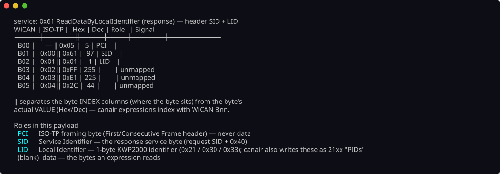
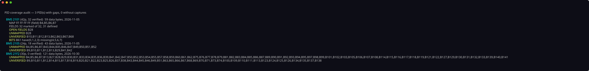

# 6. Analyze

You have captures. Now work out **which byte is which signal**. This is the core of
reverse-engineering. It is a *reasoning* process, not one command:

1. **Inspect** — see which bytes move.
2. **Reason** — form a hypothesis about what the byte could be. Base it on what the electronic
   control unit (ECU) is and how the byte behaves.
3. **Test** — check the hypothesis against the data without committing anything. Use a known
   reference, a plausible range or a correlation.
4. **Confirm or reject** the hypothesis. Then move to the next byte.

canair's analysis tools support each step. All of them work on your saved captures, so you need no
live car. This page shows the workflow on a real example: finding vehicle speed.

!!! tip "Short on time? Start here"
    1. Run `canair investigate MyECU 2101`. It gives one ranked report for every byte of a parameter
       identifier (PID).
    2. Read [the one-shot shortcut](#the-one-shot-shortcut-investigate).
    3. If you know a signal that should move with the byte, run
       `canair hunt MyECU 2101 --against REF`.
    4. Go on to [7. Define & verify](07-define-and-verify.md) when a byte matches.

    For a table of "I have X, I want Y", see
    [Which analysis command when](../concepts/analysis-commands.md).

## First, two families of signal: continuous vs discrete

Before you reason about any byte, work out which of two families it belongs to. The families need
**different analysis tools**. A wrong choice sends you down a dead end. An example is a Pearson
correlation of a gear enum against speed.

**Continuous signals** are a value on a number line. Examples are speed, voltage, current,
temperature, revolutions per minute (RPM) and state of charge. Neighbouring values are close in a
meaningful way (91 km/h is just above 90). Arithmetic is valid: the mean, the min/max and a linear
`scale·x + offset` all make sense. Pearson correlation, `--stats` distributions and linear fits
are built for these signals. Most powertrain sensor bytes are continuous.

**Discrete signals** take a value from a fixed set. The number is a *label*, not a quantity:

- **Enums and state machines** — gear, drive mode, fan level, charge state. These are a small set
  of distinct integers. `Drive=3` is not "one more than" `Neutral=2`, so spacing, averages and
  min/max have no meaning.
- **Bitfields and flags** — doors, locks, lights, relays. Individual bits toggle independently
  with discrete physical events.
- **Counters and checksums** — a rolling frame counter or a cyclic redundancy check (CRC). These
  have many distinct values but no physical quantity to decode. Learn to recognise them, so that
  you do not waste time on a scale fit to noise.

Body and comfort modules (the body control module (BCM), IGPM and the heating, ventilation and air
conditioning (HVAC) module) are mostly discrete. Powertrain modules (the battery management system
(BMS), the motor control unit (MCU) and the vehicle control unit (VCU)) are mostly continuous.
They also have a few enum and flag bytes, such as contactor state and drive mode.

The split decides which tools you use:

| | Continuous | Discrete (enum / flag) |
|---|---|---|
| Fingerprint | many values, smooth motion | few distinct values, or independent bit toggles |
| Right statistic | Pearson/Spearman `r`, mean/stdev, variance-F | Cramér's V, mutual information, edge timelines |
| canair tools | `hunt`, `correlate`, `decode --stats` / `--corr` / `--discriminate` | `correlate --method cramers_v`, `investigate --bits` / `--events`, `decode --discriminate` |
| Model | linear `expression` (scale + offset) | `type: enum`/`bitmask` + a `values:`/`bits:` map |

The quickest classifier is the `--stats` **`distinct`** count over a varied drive. A byte with 2–8
distinct values, or a byte whose bits toggle independently, is almost certainly an enum or flag.
A byte with dozens of smoothly changing values is continuous.

The worked example below (finding vehicle speed) follows the **continuous** path. The **discrete**
path (typed signals and categorical statistics) is in
[Categorical signals](#categorical-signals-modes-flags-schedules) further down.

## Step 1 — Inspect: which bytes move?

A byte that never changes across your captures cannot be a live signal. Start by diffing captures
of the same PID taken in different conditions:

```bash
canair captures uds MyECU:2101 --diff --state driving   # byte-level diff across a drive
canair captures uds MyECU:2101 --diff --rulers          # overlay the byte-index ruler
```

`captures`, `correlate` and `hunt` each have a `uds` kind and a `can` kind. `uds` is the
diagnostic domain and the default, so a bare `canair captures MyECU:2101 …` works too. The `can`
kind targets raw broadcast frame logs from the controller area network (CAN).

The bytes that **change** are your candidates. The bytes that light up between parked and driving
carry motion-related information. Map the raw payload to byte indices, so that you know exactly
what you look at:

```bash
canair bix --annotate 6101FFFF… --ecu MyECU --pid 2101
```



> Byte indexing is a common trap. WiCAN, ISO-TP (the transport layer for CAN frames) and Torque
> count bytes differently. Transport bytes (protocol control information, PCI) also exist, and you
> must not read across them. See
> [Byte indexing](../concepts/byte-indexing.md).

### Reading several PIDs at the same instant

`--diff` shows the history of one PID. Sometimes the question is: *"what did **that** byte do
while **this** other signal changed?"* In that case, step through the captures. canair stacks the
PIDs into one time-joined frame:

```bash
canair captures uds "MyECU:2101,2102" --step              # two PIDs, stacked
canair captures uds "HVAC:220100,2201A0,2201A2" --step    # duct temps vs heat mode
canair captures uds "VCU:2101 BMS:2101" --step            # across two ECUs
```

Each frame is anchored on a capture timestamp. canair joins the other PIDs to the nearest capture
within `--join-tol`. The default is 10 s, which is wide enough to span a full round-robin
`monitor` cycle over several ECUs. Each block shows its `Δt` from the anchor. If a PID has no
capture in range, canair reports it and does not hide it. You therefore always know whether you
look at a real simultaneous reading.

These keys work inside the stepper:

- `←`/`→` (or `h`/`l`) move between frames.
- `↑`/`↓` (or `k`/`j`) scroll a tall frame.
- `g`/`G` go to the first or last frame. `Home`/`End` go to the top or bottom of the view.
- **`p`** adds or removes signals from the comparison.
- **`J`** changes the join tolerance.
- **`V`** switches the rendering. `signals` drops the hex to fit more PIDs. `changed` shows only
  signals whose value moved.
- **`tab`** picks a block, so that **`e`** can annotate that capture.
- **`?`** lists every key.

**Moving between frames keeps your scroll position.** A stacked frame is usually taller than the
terminal. Scroll to the byte you care about and step with `←`/`→`. The view stays put and the
numbers underneath change. This makes the stepper a comparator, not a pager. When the header
scrolls out of sight, the status bar repeats the timestamp of the frame. `Home` takes you back to
the header.

This is the fastest way to watch an event-driven signal. Put the *known* signal (a compressor flag
or a door state) in the same frame as the *candidate* byte. Then walk the frames across the
moment it switched.

**Leave yourself landmarks.** Press **`e`** on any frame to annotate that capture ("Heating
started", "pressed the lock button"). Press **`s`** later to jump back to it. The jump list shows
every session in scope, newest first, with its noted captures nested underneath. Write the note
while you remember what you did. Analysis then becomes "jump to the event, then step outward".
canair stores notes with the capture, and they show up in `canair captures --sessions`.

To see what is still undecoded across a whole ECU (or PID), use `canair coverage`. It audits every
signal expression against the payload length of the newest session of the PID. It lists the
**unmapped** and partially decoded bytes. [Audit for gaps](07-define-and-verify.md#audit-for-gaps)
describes every finding and how canair chooses the length. The usual scope flags apply, so
`--until DATE` audits against the history as it stood on that date:



### Finding text: part numbers, versions, VINs

Everything above starts from "which ECU, which PID". Sometimes you want *text*: a part number, a
software version or an ECU name. You often do not know where it lives. `canair search` asks the
whole capture store:

```bash
canair search 95400G7470          # which ECU/PID holds this part number?
canair search                     # list every plausible string in the captures
canair search --hex 'DE AD BE EF' # a byte pattern instead of text
```

canair groups findings by **location**, not by capture. Each group shows a hit count and the dates
of the first and last sighting. Each payload hit carries a ready-to-run
`canair pids upsert-param … --type ascii` command. Fill in the signal name, and a string you found
is one step from a defined signal. The inventory shows only identifier-looking strings. Numeric
telemetry is often printable ASCII, so an unfiltered sweep is mostly noise. `--all-runs` shows
what that looks like.

A string never includes the response header. The header is the service byte and the echo of the
data identifier (DID) or local identifier (LID). It is often printable. canair also searches the
raw responses that a scan records in its notes, as bytes. It marks these hits `from scan notes`,
and `lossy` where the note was cut short. To search for text that is also a kind name, put it
after `--`: `canair search -- uds`.

## Step 2 — Reason: what could this byte be?

Before you guess offsets, ask *what this ECU needs to report*. The job of an ECU limits what its
bytes can be:

- A **BMS** reports cell voltages, pack current (signed, symmetric about zero), temperatures
  (slow-moving) and state of charge (0–100%).
- An **MCU/inverter** reports motor RPM and torque (signed, symmetric under regeneration). It also
  reports several component temperatures.
- A **body module** (BCM/IGPM) reports mostly *discrete* things, such as lights, locks and doors.
  It reports them as **bitfields**, not continuous values.

The *behaviour* of the byte narrows the choice further:

- **Range and distribution** — a value bounded 0–100 is likely a percentage. A value symmetric
  about zero is likely signed (torque, current).
- **Speed of change** — temperatures drift slowly. Loads and currents jump fast.
- **Distinct values** — a handful of discrete integers is an enum or state machine, not an analog
  reading.

In our example, a byte sits at 0 while parked. It climbs smoothly to about 100 as you accelerate
and stays non-negative. This looks like **speed in km/h**.

`canair decode --stats` gives you the distribution to reason from:

```bash
canair decode MyECU 2101 --stats                  # n / distinct / mean / stdev per byte
canair decode MyECU 2101 --stats --group-by state # per-state means (parked vs driving)
```

## Step 3 — Test the hypothesis (without committing)

Now confirm the hypothesis with evidence. The strongest method is a **correlation against a
signal you already trust**. This is often a known signal on *another* ECU, captured during the
same drive.

**If you have a reference signal**, let `canair hunt` search for you. It sweeps every byte offset
and interpretation on the PID. It correlates each one against the reference. It reports the best
fit with a guess at the physical unit:

```bash
canair hunt uds MyECU:2101 --against ESC:22C101:REAL_SPEED_KMH
# → B12  r=0.99  y = 1.00·x + 0.3   (looks like km/h)
```

> `ESC:22C101:REAL_SPEED_KMH` is a *known* speed signal from the bundled Ioniq profile. It
> illustrates the technique only. On your car, the reference is a signal that *you* have already
> verified, or an external anchor such as GPS-logged speed. The technique is the same.

**Reference an external log** with `--against-file`. The log can come from a calibrated meter, a
global positioning system (GPS) speed track or a grid-voltage export. The file is a two-column
`timestamp,value` CSV (comma-separated values). canair joins it by nearest timestamp, exactly like
an on-bus reference. This is the only way to hunt a signal that has *no* correlate on the bus:

```bash
canair hunt uds MyECU:2101 --against-file gps_speed.csv    # vs an external track
canair correlate uds --against-file grid_voltage.csv       # rank every byte vs it
```

> The CSV must use the same absolute wall clock as your captures. canair parses a relative or
> zero-based log, but it joins to nothing and reports `n=0`.

An `r` near 1.0 on byte 12, with a fit of about 1:1, is strong evidence that **byte 12 is speed in
km/h**. The data has now confirmed our hypothesis.

**If you are not sure what relates to what**, let `canair correlate` rank *every* strong
cross-signal relationship in the drive. Then focus on the best ones:

```bash
canair correlate uds --overlap --state driving   # which PIDs share a timeline?
canair correlate uds --state driving              # rank the strongest pairs
```

**Test an exact expression** against all captures without editing any YAML:

```bash
canair decode MyECU 2101 --try "SPEED_KMH=[B12]" --stats
canair decode MyECU 2101 --try "SPEED_KMH=[B12]" --corr ESC:22C101:REAL_SPEED_KMH
canair decode MyECU 2101 --plot               # interactive: sweep interpretations visually
```

`--plot` opens an interactive explorer. In it, you can:

- step through signals and bytes
- sweep `u8`/`i16`/`f32` interpretations and endianness
- apply transforms
- read off the equivalent WiCAN expression

It works on your saved captures, so you need no car:


**Dump the raw bytes** as a `timestamp × byte-offset` matrix when you want to analyze outside
canair, for example in a spreadsheet or a scratch script. This is the structured escape hatch. The
output is CSV by default, or JSON with `--json`:

```bash
canair decode MyECU 2101 --dump-bytes                 # CSV to stdout (PCI skipped)
canair decode MyECU 2101 --dump-bytes --json          # same, as JSON
```

## When a signal fights back: confounders, plausibility, independence

Correlation-based tools fail on a signal that has **no clean anchor on the bus**. A dominant driver
may mask such a signal, or it may correlate with nothing at all. Three methods help in these
cases. The [AC input voltage case study](../case-studies/ac-input-voltage.md) shows all three:

```bash
# Confounder control: rank by the PARTIAL correlation, with a nuisance signal
# regressed out — surfaces a link hidden behind a dominant driver.
canair hunt uds OBC:2101 --against-file grid_v.csv --control OBC:2101:OBC_DC_A

# Physical plausibility: no reference at all — flag bytes whose scaled value
# lands in a named band (mains RMS/peak, line freq, 12V rail, HV pack).
canair hunt uds OBC 2101 --physical --state charging

# Active-but-independent: rank bytes that separate by state yet DON'T track a
# named driver (the fingerprint of AC voltage vs charge current).
canair investigate MyECU 2101 --independent-of OBC:2101:OBC_DC_A --state charging
```

!!! tip "800 V pack or a non-EU grid? Tune the bands first"
    The physical bands default to a ~400 V electric vehicle (EV) on a 230 V / 50 Hz grid. If your
    car or grid does not match, the `--physical` scan may find nothing and give no warning. Set
    your values before you run `--physical`:

    - For an **800 V architecture**, set the high-voltage (HV) band in your profile:
      `physical_bands: { hv_pack: [450, 850] }`. See [Profiles](../concepts/profiles.md).
    - If you are **not on a 230 V / 50 Hz grid**, set your region:
      `canair config set grid_region US`. See [Configuration](../reference/config.md).


## The one-shot shortcut: `investigate`

`canair investigate` combines inspect, reason and correlate in one report. For every varying
byte, it tells you three things:

- whether a signal already maps the byte
- how well the byte separates across vehicle states
- the strongest relationship of the byte to a co-captured signal, with a unit guess

Point it at an unknown PID first:

```bash
canair investigate MyECU 2101 --state driving
canair investigate MyECU 2101 --bits     # rank toggling bits too (body/discrete signals)
canair investigate MyECU 2101 --events   # edge timeline for narrated door/lock/hood captures
```

Each byte also carries a one-word **triage class**: `constant`, `counter`, `checksum` or `enum`.
canair leaves a live analog byte unlabelled. The class is a cheap first read of what kind of field
the byte is.

A **probable multi-byte words** section flags adjacent `[Bn:Bn+1]` pairs that look like a scaled
16-bit value. The shape is a near-constant high byte next to a full-range low byte. A scaled
voltage takes this shape when it hides across a byte boundary.

`investigate` is the fastest way to get oriented. Use the individual tools above to follow up on
what it finds.

### Odometers, hour meters and cycle counts: `--counters`

The triage `counter` class above finds a *fast rolling* byte, such as a message or alive counter
that cycles through every value. It cannot find the counters you usually want to name, because
they are slow. An odometer or an operating-hours tally does not move at all within one recording
session. It looks **constant** to every tool on this page, correlation included.

`--counters` asks the one question that finds them: *which byte windows only ever go up across the
entire capture history?*

```bash
canair investigate MyECU 2101 --counters
canair investigate MyECU 2101 --counters --unmapped-only   # skip what's already verified
```

It sweeps windows of 1–4 bytes in both endiannesses. A real odometer usually uses 3 or 4 bytes.
It sorts the hits into three classes:

- **Accumulators** rise within sessions too. Examples are an odometer and cumulative Ah/Wh.
- **Cycle counters** stay flat inside every session and step only between sessions. Examples are
  ignition counts and trip counts.
- **Run timers** ramp and reset each session, and they track wall-clock time. An example is
  uptime.

Two points matter before you trust a hit:

- **Evidence is reported in bits.** Each clean rise with no fall is one bit. A window at 3 bits
  rose three times and never fell. That is a 1-in-8 coincidence, so it is a *lead*, not a
  finding. A long-running accumulator scores in the hundreds. Do not write off a signal because of
  a handful of bits. Get more captures across more days.
- **Do not scope it.** This is the one analysis that needs your whole history. `--state` and
  `--since` shorten the horizon, and the horizon is the evidence.

The magnitude usually identifies the signal on sight. A 3-byte window that reads `70047 → 73048`
over four months is a kilometre odometer. A window that reads `21268317 → 22312975` at about one
per second is an operating-second counter. Cross-check a distance candidate against the odometer
of your instrument cluster. To confirm it is *distance* and not *time*, check that its ratio to a
known time counter is not constant.

See [Analysis commands](../concepts/analysis-techniques.md#counters-the-one-thing-correlation-cannot-find)
for the fingerprint table and the ISO-TP window details.

## Categorical signals: modes, flags, schedules

This is the **discrete** family from the taxonomy above. Examples are a fan level, a climate mode,
a gear and a day-of-week schedule mask. The worked speed example took the continuous path. Here
the numeric spacing has no meaning (`Drive=3` is not "one more than" `Neutral=2`). Pearson
correlation and the variance-F therefore do not apply.

canair models these as **typed** signals (`enum`, `bitmask`, `ascii`, `date` and `struct`). It
analyzes them with *categorical* statistics. See [Typed signals](../concepts/typed-signals.md) for
the model. These commands do the analysis:

```bash
# "Which byte is the gear?" — rank by nominal association, not linear r
canair correlate uds VCU --against VCU:2101:GEAR --method cramers_v

# "Which byte separates the power states?" — Cramér's V for typed signals
canair decode VCU 2101 --discriminate state

# Once defined as an enum, see the transitions as labels over time
canair investigate VCU 2101 --events --field GEAR
# → 10:05:00  park (33) → drive (40)
```

`--method cramers_v` and `--method mutual_info` treat each distinct value as a nominal category.
This is the right question for a mode, flag or enum byte. For the discrete bits of a body module,
`investigate --bits` and `--events` remain the entry points.

## Decoding "set" commands: toggle and diff

Some of the most interesting signals are not *read*. The car **writes** them. Examples are a
preheat schedule, a clock or a charge timer that the head unit sets. Two things make these signals
harder:

1. On a gateway-isolated On-Board Diagnostics (OBD) port, you often cannot *sniff* the write
   itself. See [Broadcast frames](../concepts/broadcast-frames.md) for the raw-CAN path when you
   can.
2. The result is a **structured record** (day mask plus time), not one byte.

The reliable workflow that needs only the device is **toggle → re-read → diff**:

```bash
# 1. Read the DID that you expect to store the setting, before the change
canair read <ECU>:<DID> --save --label "schedule: before" --state ready

# 2. Change the setting on the car (set preheat to a different day/time)

# 3. Re-read the same DID, after
canair read <ECU>:<DID> --save --label "schedule: after" --state ready

# 4. Diff the two payloads to see exactly which bytes moved
canair captures uds <ECU>:<DID> --diff

# 5. Model the bytes that moved as a typed field and test it
canair pids upsert-param <ECU> <DID> SCHEDULE_DAYS B<nn> \
    --type bitmask --bit 0=mon --bit 1=tue --bit 2=wed --bit 3=thu \
    --bit 4=fri --bit 5=sat --bit 6=sun --unverified
canair decode <ECU> <DID>
```

Do step 5 only for bytes that moved in step 4. If nothing changes, the setting lives in another
DID, or a command that you cannot see writes it. In that case, go back to step 1 with a different
candidate. Do not model a byte that never moves.

For a whole schedule record, define a `struct` signal. Its ordered `fields:` cover the day mask,
the hour and the minute. `investigate --events --field` then reads each schedule change as one
logical `{days=…, hour=…, minute=…}` transition.

## Be rigorous

A hypothesis stays a hypothesis until the data confirms it. Do not accept a byte because it "looks
about right". Check the range, the distribution, the correlation against a known reference and the
physical plausibility across states. State your confidence honestly. For this reason, the next
step starts every new signal as **unverified**.

> The `reverse-engineer-signal` agent skill (`.claude/skills/reverse-engineer-signal/`) documents
> the full reasoning toolkit in depth. The toolkit includes thermal-mass tricks, signed and
> symmetry tests, conservation laws (P ≈ V·I), enum and counter fingerprints, and endianness
> sweeps. This page is the human-facing tour of the same workflow.

> **See it fight back:** [Finding the hidden AC input voltage](../case-studies/ac-input-voltage.md)
> is a full case study of this workflow. It applies the workflow to a signal that resisted every
> obvious approach. Read it to see *why* the rigor above matters.

---

You now have a confident hypothesis (*"byte 12 of `MyECU:2101` is speed in
km/h"*). Next: **[7. Define & verify →](07-define-and-verify.md)** turns it into a
stored signal.
