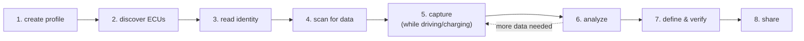

# Bring your own car

The bundled Ioniq profile is an **example**. The tooling of canair works with any vehicle. This
journey takes you from *nothing* to decoded, verified diagnostic signals for **your** car. You
store the result in a [profile](../concepts/profiles.md) that you can share.

You do not need to know the PIDs of your car in advance. The discovery and scan commands are a
**write path**. They add what they find to the profile, so the profile grows while you work.

## The arc

In words: you do steps 1 to 8 in order. If the analysis in step 6 shows that you need more data,
you go back to step 5 and capture again.

| Step | You do | Result |
|---|---|---|
| [1. Create a profile](01-create-profile.md) | `canair profile create` | An empty, valid profile bundle |
| [2. Discover ECUs](02-discover-ecus.md) | `canair discover --register` | Every responding ECU written into `ecus/` |
| [3. Read identity](03-identity.md) | `canair identity` / `discover --identify` | Part numbers, versions, VIN |
| [4. Scan for data](04-scan.md) | `canair scan` | Which PIDs/DIDs each ECU answers |
| [5. Capture](05-capture.md) | `canair read … --save` | Real payloads with driving/charging context |
| [6. Analyze](06-analyze.md) | `decode` / `correlate` / `hunt` / `investigate` | Which byte *is* which signal |
| [7. Define & verify](07-define-and-verify.md) | `canair pids upsert-param`, `coverage` | Named signals in `ecus/` |
| [8. Share](08-share.md) | `canair wican autopid write` | WiCAN AutoPID JSON and a profile to contribute |

There is an optional side journey. [9. Broadcast CAN frames](09-broadcast-frames.md) decodes
signals that the car *broadcasts* on its internal bus, such as drive mode, regen and wheel speeds.
The ECUs do not answer these on request. The side journey is a parallel import, analyze and define
arc. Use it when you have a raw frame log. See also
[Broadcast CAN frames](../concepts/broadcast-frames.md).

## It's a loop, not a line

Reverse engineering is iterative. You often capture data and analyze it. Then you find that you
need *different* conditions, for example accelerating or coasting, and plugged in or charging.
Then you capture again. This is normal. The dashed arrow in the diagram shows it.

The rule: **read and capture freely, define conservatively.** Mark new signals `--unverified`.
Promote a signal only after you confirm it against a known reference, or across enough captures.
See [Define & verify](07-define-and-verify.md).

## Before you start

Complete [Getting started](../getting-started/install.md) first. canair must be installed, your
dongle must be configured, and `canair status` must report a reachable device. Every step below
needs this.

---

Next: **[1. Create a profile →](01-create-profile.md)**
