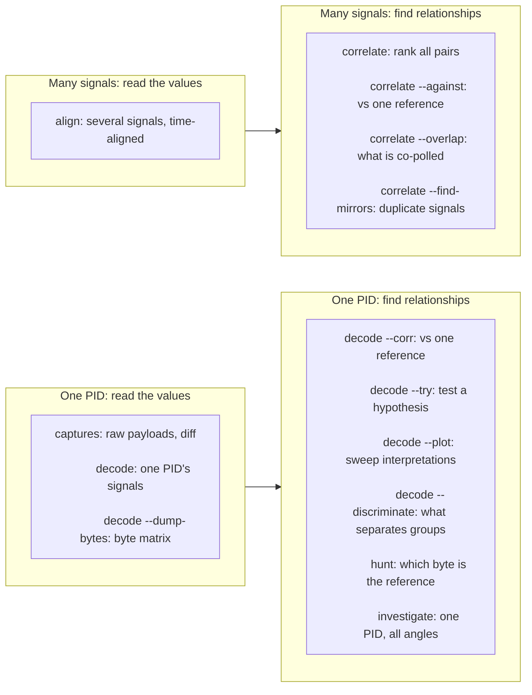
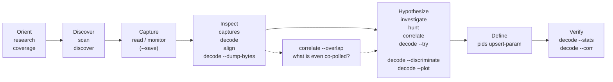

# Which analysis command when

The offline analysis commands of canair look like a large family, but two questions organize
them. Every command answers one of these:

- **"What are the values?"** — read the decoded or raw data
- **"How do signals relate?"** — find correlations, separations and mirrors

Each command works at one of two grains: **one PID** (parameter identifier) or **many signals / a
whole drive**. This gives four quadrants. They are the fastest way to pick the right tool.

## The map



`captures` and `decode` are the "look at it" tools. `investigate`, `hunt` and `correlate` are the
"reason about it" tools. **`align`** reads *several* signals side by side. The sequence
`decode --try` → `pids upsert-param` → `decode --stats`/`--corr` is the define→verify loop.

**`search`** answers a different question: *where is this text?* It needs no target at all. It
scans every payload for a part number, version string, vehicle identification number (VIN) or byte
pattern. If you give it none, it lists every plausible string.

Two tools sit outside the map because they need **no reference signal at all**. They judge a byte
by its own shape instead of by what it tracks:

- `hunt --physical`: does its scaled value land in a named physical band?
- `investigate --counters`: does it only ever go *up*?

Use these when a PID has nothing co-polled to correlate against.

## "I have X, I want Y → use Z"

| I have… | I want to… | Command |
|---|---|---|
| an unknown PID, no idea | everything about it in one shot | `investigate <ECU> <PID>` |
| a **known reference** signal | which *byte* on a target PID **is** it | `hunt <ECU> <PID> --against REF` |
| a known reference signal | *everything* that tracks it across a drive | `correlate --against REF` |
| nothing specific | the strongest relationships in a whole drive | `correlate` (bare) |
| a candidate expression | to test it without editing YAML | `decode --try "N=EXPR"` |
| a defined PID | its value ranges / stats / distribution | `decode [--stats]` |
| a grouping signal (state, mode, on/off) | which bytes *separate* the groups | `decode --discriminate <axis>` |
| several signals from different electronic control units (ECUs) | them **side-by-side, time-aligned** | `align "A:B:C D:E:F"` |
| several PIDs' **raw captures** | to read them at the same instant, frame by frame | `captures "A:P1,P2" --step` |
| raw bytes of one PID | the timestamp×byte matrix | `decode --dump-bytes` |
| raw payloads | the hex / byte-diff / sessions index | `captures` |
| a part number, version or VIN | which ECU/PID holds it | `search <TEXT>` |
| nothing, just the captures | every part number / version string in them | `search` |
| a nearly finished profile | what bytes are still undecoded | `coverage` |
| the end of a session | what to work on next | `research` |
| an ECU known only by its actuators | which of its DID families were never read | `research --gaps` |
| a confounder to remove | correlation with a nuisance regressed out | `… --control REF` (hunt/correlate) |
| no on-bus anchor | a byte that lands in a physical band | `hunt --physical` |
| a suspected odometer / hour meter / cycle count | the bytes that **only ever rise** | `investigate <ECU> <PID> --counters` |
| no idea which PID hides a counter | every counter in the car, ranked | `investigate --counters` (bare) |
| a body/climate ECU with many bit-flag DIDs | which of their bits are **real signals** at all | `investigate <ECU> --support-map` |

## Where each sits in the RE lifecycle



In words: you orient, discover, capture, inspect, hypothesize, define and verify, in that order.
`correlate --overlap` helps while you inspect and hypothesize, because it shows which signals canair
polled at the same time.

## `align` vs the correlation tools

Both use the *same* nearest-timestamp join, but they differ in what they emit:

- **`align`** emits the **data**: a wide `time × signals` table that you read, regime-split or
  export (`--csv` joins with a `decode --dump-bytes` comma-separated values (CSV) file, or with
  an external meter log via `--against-file`). Use it to *see* several signals together, or when
  you would otherwise write a one-off join script.
- **`correlate` / `hunt`** emit **relationships**: ranked correlation summaries (r, linear fit,
  unit guess). Use them to *quantify* how signals relate.

**`captures --step`** with a multi-PID QUERY is a third shape of the same join. It emits neither a
table nor a coefficient. It emits the **raw captures themselves**, stacked one block per PID in a
time-joined frame (decoded signals + byte-diff hex). Use it when you want to *look at the bytes*
of several PIDs at one instant. A typical use is to walk the frames across the moment a known
signal switched.

You can edit the PID set, the join tolerance and the rendering inside the text user interface
(TUI). `--json` emits the same frames as data. See
[Analyze](../bring-your-own-car/06-analyze.md#reading-several-pids-at-the-same-instant).

## `--discriminate` by any axis

`decode --discriminate` ranks which signals, bytes or bits most cleanly separate across groups.
The axis is one of these:

- **`state`** — the vehicle power state (charging / ready / driving)
- **a cross-signal `ECU:PID:PARAM`** — canair groups by the discretized value of that signal

```bash
# which byte separates heat-pump heating being on from off?
canair decode HVAC 2201A2 --discriminate HVAC:220102:HVAC_HEAT_PUMP_ON --bytes
```

canair nearest-joins the axis signal onto each capture and discretizes it into low-cardinality
groups (enum, flag or mode). It rejects an axis that is too continuous. It scores numeric signals
with an F ratio, and typed enum/bitmask signals with Cramér's V.

## Scope every analysis to the right drive

All of these commands share the scope flags (`--since`/`--until`/`--date`, `--state`, `--label`,
`--today`, `--last-session`). See [Vehicle states](vehicle-states.md) and
[Captures & states](captures-and-states.md). The natural unit is usually a `--state` (for example
`--state charging`) or a single session.

!!! note "keep-mode caveats"
    The monitor records **every poll** by default (`--keep-all`), so a stored row is a real
    sample. canair folds repeated payloads on disk, so this costs little space (see
    [Capture file format](capture-format.md)). Two dedup modes appear in older captures:

    - `keep:changes` (`--keep-changes`, still available) is **run-length**. It stores every
      genuine value transition, so `A→B→A` survives and you can recover dwell durations from
      timestamps. It collapses only immediate repeats.
    - The retired `keep:unique` was **global** dedup. Return-to-previous transitions and
      durations are therefore absent.

    `align`/`decode`/`correlate`/`investigate` print a `note:` on stderr when `keep:changes`
    sessions are in scope, because a **stored-row count then measures volatility, not sampling**.
    An ECU that canair polls every cycle but that rarely changes looks "barely polled".
    `keep:unique` gets no blanket note (many historical captures use it). The commands flag it
    only where it changes a reading: the `investigate --events` dwell classes, the
    `--transform`/`--lag-scan` time-gap warnings and a forced `--fill hold`. Rate and `delta`
    analysis is unreliable on either mode.
    Record with the default keep-all when you need the real sampling cadence.

