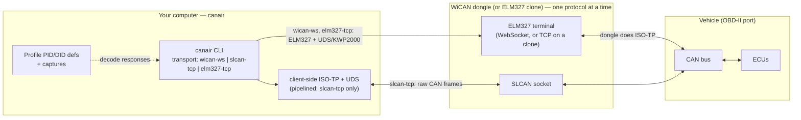

# How canair connects

canair **never talks directly to the controller area network (CAN) bus**. It reaches the bus
through an adapter. The adapter is a WiCAN dongle or a generic ELM327 clone (a common on-board
diagnostics (OBD-II) adapter). canair connects to the adapter over one of several transports that
you select explicitly. canair parses the responses and decodes them into named signals. It uses the
definitions of the active [profile](profiles.md).

## The path from canair to the car

In words: canair sends a request. With `slcan-tcp`, canair splits and joins the CAN frames itself.
With `wican-ws` and `elm327-tcp`, the dongle does this. The dongle puts the frames on the CAN bus
of the car. An electronic control unit (ECU) answers. The response returns along the same path,
and canair decodes it into named signals with the definitions of the active profile.

## Transports

The device runs **one protocol at a time**. Run `canair status` to check which one is active.

- **`slcan-tcp`** (default) — a raw serial-line CAN (SLCAN) frame stream over TCP. canair runs
  the ISO 15765-2 transport protocol (ISO-TP) and the Unified Diagnostic Services (UDS) protocol
  itself. It pipelines requests across ECUs. This transport works on
  **any WiCAN (Pro or classic)** or gateway. It also powers `canair sniff`.
- **`wican-ws`** (Pro only) — the ELM327 emulation of the WiCAN Pro over a WebSocket. The *dongle*
  runs ISO-TP.
- **`elm327-tcp`** — a **generic ELM327 adapter** over a plain TCP socket. Examples are the $10
  WiFi clones (Kiwi, vLinker, OBDLink, no-name dongles) and the `-n` mode of the
  [ELM327-Emulator](../development/offline-testing.md). This transport needs no WiCAN and no HTTP
  configuration API. It needs only the ELM327 terminal on a TCP port (usually 35000). The *dongle*
  runs ISO-TP.

`slcan-tcp` is the default because it runs on both WiCAN hardware variants. Select a transport
with `--transport` or the `transport:` block of the config.

The two ELM327 transports (`wican-ws`, `elm327-tcp`) share one ELM327 protocol engine. Only the
byte channel differs (WebSocket or plain TCP). Every command therefore works the same way over
each of them.

!!! note "WiCAN is recommended; third-party dongles are best-effort"
    The `elm327-tcp` transport lets you use any generic ELM327 clone. The **WiCAN is the
    best-tested adapter** for this project, and we recommend it. Cheap clones vary in firmware
    quality, and we cannot guarantee that they are reliable. They are especially likely to fall
    short on **newer vehicles**. These vehicles depend on long multi-frame ISO-TP payloads and on
    **extended (29-bit) addressing**. See
    [Connect your dongle](../getting-started/connect-device.md#using-a-generic-elm327-clone-no-wican).

## Protocols

- **UDS** (ISO 14229) — the modern diagnostic protocol.
- **KWP2000** (ISO 14230) — the older protocol (Keyword Protocol 2000) that some ECUs still speak.
- **ISO-TP** (ISO 15765-2) — the multi-frame transport underneath both.
- **SLCAN-over-TCP** and **ELM327 AT** — the link between the host and the dongle.

Which ECUs speak which protocol is **vehicle-specific**. canair selects UDS or KWP2000 for each
ECU. It uses the profile registry or an on-device probe. On the bundled Ioniq, for example, the
powertrain ECUs (BMS, VCU, MCU, OBC) speak KWP2000, and the body and comfort ECUs speak UDS.
Another car may split them differently.

## Two data domains

canair handles two parallel kinds of data:

- **Diagnostics** — request/response UDS/KWP2000 (mature: `read`/`scan`/`dtc`/…).
- **Raw frames** — passively sniffed broadcast traffic that no request elicits (`canair sniff`).

Both are first-class. The transport layer treats the WiCAN as a *replaceable* way to reach the
bus. A generic ELM327 clone (`elm327-tcp`) already fits behind the same interface. A future
SocketCAN or replay backend could fit there too.
