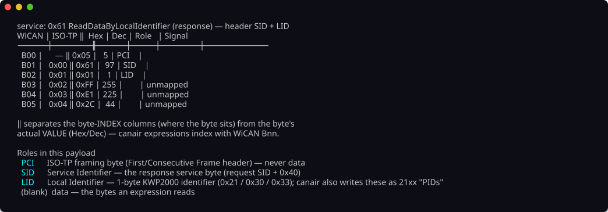

# Byte indexing

The most common reverse-engineering mistake is a **wrong byte offset**. WiCAN, ISO 15765-2
transport protocol (ISO-TP) and Torque each count bytes differently. If you port a known
diagnostic parameter ID (PID) from another tool or car and ignore this, the port fails without an
error.

## Three ways to count the same payload

A Unified Diagnostic Services (UDS) response arrives as ISO-TP frames on top of the controller
area network (CAN). The "same" byte has a different index in each notation. The index depends on
where you start to count. It also depends on whether you include the framing bytes of the
transport, called protocol control information (PCI) bytes.

- **WiCAN index** — the index into the raw CAN frame data, **including** the ISO-TP PCI bytes.
  The WiCAN AutoPID feature uses this index for addressing. It causes most of the confusion when
  you port PIDs.
- **ISO-TP index** — the index into the pure reassembled ISO-TP payload, with the PCI bytes
  stripped. SavvyCAN and ImHex-style tools show this index.
- **Torque / OBDb bix** — the index into the actual **UDS** payload, counted from the first data
  byte. This index skips the service header (SID plus sub-function), so the offset depends on the
  size of the header:

    - **Torque 1** applies to `21xx` PIDs (1-byte sub-function).
    - **Torque 2** applies to `22xxxx` data identifiers (DIDs) (2-byte sub-function).

    `canair bix` reads the header size from the service of the payload. It names the active
    variant, so it is clear that the Torque mapping is *not* fixed. Use `-1` or `-2` to override
    it.

## The header is not always "SID + 1 or 2 bytes"

The number of bytes between the service identifier (SID) and the first *data* byte depends on the
**service**. It is not only a width. The fields have names and an order:

| Response | Header after the SID | First data byte at ISO-TP |
|---|---|---|
| `62 xx xx …` (`0x22` ReadDataByIdentifier) | `DID` (2) | 3 |
| `61 xx …` (`0x21` ReadDataByLocalIdentifier) | `LID` (1) | 2 |
| `41 xx …` (OBD-II mode `0x01`) | `PID` (1) | 2 |
| `6F xx xx yy …` (`0x2F` IOControl) | `DID` (2) + `CTRL` (1) | 4 |
| `71 ss xx xx …` (`0x31` RoutineControl) | `SF` (1) + `RID` (2) | 4 |
| `7F ss nn` (negative response) | `REJ SID` (1) + `NRC` (1) | — |

Service `0x31` puts its sub-function **before** the routine ID. Service `0x2F` puts its control
parameter **after** the DID. A "subfunction width" of 1 or 2 bytes cannot express either layout.
For this reason, `canair bix --annotate` labels each header field from the service (see below).
The table lives in `src/canair/uds/layout.py`.

!!! warning "The WiCAN↔ISO-TP offset depends on the response's length"

    The number of PCI bytes in front of the data is not fixed:

    | Response | PCI bytes | First data byte |
    |---|---|---|
    | **Single frame** (payload ≤ 7 bytes) | **one** (`0x0n`) at `B00` | `B01` is the SID |
    | **Multi frame** (payload > 7 bytes) | **two** (`0x1n nn`) at `B00`–`B01`, then one `0x2n` at `B08`, `B16`, … | `B02` is the SID |

    The *same* WiCAN index is therefore a different ISO-TP byte, depending on the payload length.
    A 7-byte `22xxxx` response puts its first data byte at `B04` = ISO-TP 3 = Torque `A`. A long
    response puts ISO-TP 3 at `B05`.

    canair resolves this from the captured payload. The `--notation` labels and
    `canair bix --annotate` are therefore length-aware. Remember this when you convert by hand.
    If you assume the multi-frame layout on a short response, every byte shifts by one.

Each notation includes or excludes different framing bytes. An expression that is correct in one
notation is off by one or two in another.

## canair expressions use WiCAN `Bnn`

Signal expressions reference bytes as `[Bnn]` and bits as `[Bnn:k]`. They use the WiCAN byte
index. For example, `"[B12]"` extracts WiCAN byte 12.

## Let the tool do the conversion

Do not convert by hand. `canair bix` is the byte-index converter. It also annotates a real
payload, so you can *see* which byte is which. Run it with **no arguments** for a guided
overview. The overview has a plain-language legend for each notation and for the `PCI`, `SID`,
`PID` and `DID` Role labels. It also has a compact 2-frame table:

```bash
canair bix                       # guided overview: legend + a compact 2-frame table
canair bix B09                   # quick lookup for WiCAN byte 9 (w9 also works)
canair bix --table               # the full conversion table, grouped by CAN frame
canair bix --annotate 62B004…    # map a reassembled UDS payload (SID-first, PCI stripped)
canair bix --annotate 1012… --raw  # map an already-framed CAN payload (PCI present)
canair bix --annotate 62B004… --torque  # add the Torque letter column
canair bix --annotate 62B004… --obdb     # add the OBDb bix (bit-index) column
```

By default, `--annotate` and `--table` show only the **WiCAN**, **ISO-TP** and **Role** columns.
canair expressions use the WiCAN and ISO-TP notations. Two other notations are opt-in, each with
its own flag. Use them to cross-reference third-party PID sheets:

- `--torque` adds the **Torque** letter column. The Torque app, Car Scanner and similar OBD apps
  use this notation.
- `--obdb` adds the OBDb **bix** column. OBDb `bix` is a separate bit-index scheme.

`--annotate` expects the **reassembled UDS response payload**. This payload starts with the SID
and has the PCI bytes already stripped. The transport and the captures return payloads in this
form. `--annotate` rebuilds the framing and shows the WiCAN indices.

For a **raw CAN frame** straight from the bus (PCI bytes present), pass `--raw`. Then `bix`
indexes the bytes as they are. A UDS response SID (`0x40`–`0x7F`) and an ISO-TP PCI first byte
(`0x00`–`0x3F`) use separate ranges. `bix` warns you when the first byte contradicts the chosen
mode, so it does not label the bytes wrongly without a message.

`--table` groups its rows by 8-byte CAN frame. It uses `── Frame N ──` dividers and a `Role`
column. The `Role` column marks the ISO-TP framing (`FF PCI` / `CF PCI`) and the UDS header
(`SID` / `PID` / `DID`) bytes. You can see where the raw CAN frame boundaries fall and which rows
are framing instead of data. `--annotate` marks the same frame boundaries on a concrete payload.

### `--annotate` names each header byte from the service

`--table` has no payload. It can only assume a generic `SID` + `PID`/`DID` header. `--annotate`
**has** a payload, and the response SID identifies the service. `--annotate` therefore labels
every header byte with its actual meaning:

| Role | Meaning |
|---|---|
| `PCI` | ISO-TP framing byte — never data |
| `SID` | Service Identifier (request SID + `0x40`) |
| `SF` | sub-function byte, selecting the mode within the service |
| `DID` | Data Identifier — 2-byte UDS identifier (`0x22`/`0x2E`/`0x2F`) |
| `LID` | Local Identifier — 1-byte KWP2000 identifier (`0x21`/`0x30`/`0x33`); canair writes these as `21xx` "PIDs" elsewhere |
| `PID` | Parameter ID — 1-byte OBD-II parameter (modes `0x01`/`0x02`) |
| `RID` | Routine Identifier — 2-byte UDS routine id (`0x31`) |
| `CTRL` | inputOutputControlParameter — what the ECU was told to do |
| `REJ SID` | the rejected service's SID, echoed in a negative response |
| `NRC` | Negative Response Code — why the request was refused |
| *(blank)* | real data — the bytes your expression reads |

Below the table, `bix` prints a definition list of the roles that the payload used. Use
`--no-legend` to suppress it. A negative response also spells out the code, for example
`NegativeResponse rejecting 0x22 ReadDataByIdentifier — NRC 0x31 requestOutOfRange`. A refused
read therefore explains itself, and `bix` does not show the NRC as a data byte.

If the service is not recognised, `bix` falls back to the generic `SID` + `PID`/`DID` labelling.
It uses the width from `-1`/`-2` or `--pid`.

Add `--ecu ECU --pid PID` to `--annotate` to overlay which defined signal maps each byte. The
overlay also flags `unmapped` data bytes. This is the fastest way to find a wrong offset in an
expression:

```bash
canair bix --annotate 62B004… --ecu MyECU --pid 22B004
```

`--pid` also sets the **subfunction width** when the service of the payload cannot. A `22xxxx`
DID has a 2-byte echo. A `21xx` PID has a 1-byte echo. You rarely need `--pid` now, because `bix`
reads the response SID directly. It matters for a payload whose service `canair` does not
recognise.

An explicit `-1` or `-2` overrides everything. `bix` warns you when the flag contradicts the
service of the payload (or, if there is no service, the PID):

```
⚠ WARNING  -1 contradicts the payload: SID 0x62 is ReadDataByIdentifier (response),
           whose header is SID + DID(2B) (2 byte(s) after the SID).
```

If you rely on `--pid`, write the PID with its full service prefix (`22B004`, not the short
`B004`). A short-form DID does not state its service, so `bix` cannot tell it from a 1-byte PID.



## Switch the notation in analysis output

The analysis commands label raw bytes as WiCAN `Bnn` by default. These commands are `correlate`,
`hunt`, `investigate`, `coverage` and `decode` (`--discriminate`/`--find-mirrors`). Pass
**`--notation`** to show these labels in the notation that you find easiest to read or that you
need for cross-references:

```bash
canair correlate --against ESC:22C101:REAL_SPEED_KMH --bytes   # B10, B14 … (default)
canair correlate --against ESC:22C101:REAL_SPEED_KMH --bytes --notation isotp   # i7, i11 …
canair coverage BMS 2101 --unmapped --notation torque          # A, B, F …
```

`--notation` takes `wican` (default), `isotp`, `torque` or `bix`. It changes only the **display**.
Named signals stay the same. The machine-readable `--json` output and `--promote` always use the
canonical WiCAN form, which is the form you can promote and put in firmware. To set a persistent
default, run:

```bash
canair config set display.byte_notation isotp
```

Internally, canair models a byte position in **ISO-TP** space, which is the canonical payload
index without framing. It derives the WiCAN, Torque and bix views from this position. WiCAN is
one *view* of the byte and not the native unit of the tool.

### The byte ruler in the value views

`canair monitor --rulers` (`r` in the TUI) and `canair captures --diff/--step --rulers` draw a
**single** ruler row above the payload hex. The ruler numbers each byte column in your chosen
notation. The byte-reference column of each signal (next to its value) uses the *same* notation.
A value and the ruler therefore always name the byte in the same way:

```
      SOC_BMS      92.50 %  ✓  B9
      BATTERY_POWER 0.71 kW ✓  B15,B17-B19
 wican   02 03 04 05 06 07 09 10 11 12 13 14 15 17 18 19 …
         61 01 FF FF FF FF B4 24 A4 26 48 03 00 05 0F 30 …
```

Both views also take `--notation` and honour `display.byte_notation`.

A run of payload bytes can be non-adjacent *as shown*. WiCAN interleaves PCI framing bytes. Four
consecutive payload bytes therefore show as `B15,B17-B19`. The range `B15-B19` would wrongly
include the framing byte.

`bix` is a *bit* index, so it cannot fit a two-character byte column. If you ask a ruler for
`bix`, it falls back to WiCAN. This keeps the columns aligned. The row label always says which
notation the ruler draws.

## Further reading

The firmware-grounded reference shows how the WiCAN `Bnn` index maps onto the raw CAN frame
buffer. It is verified against the `wican-fw` source with file and line citations. See
[WiCAN byte index (firmware reference)](wican-byte-index.md).

You can show the full conversion table at any time with `canair bix --table`. The upstream
discussion of the notation differences is in
[meatpiHQ/wican-fw#514](https://github.com/meatpiHQ/wican-fw/issues/514).
