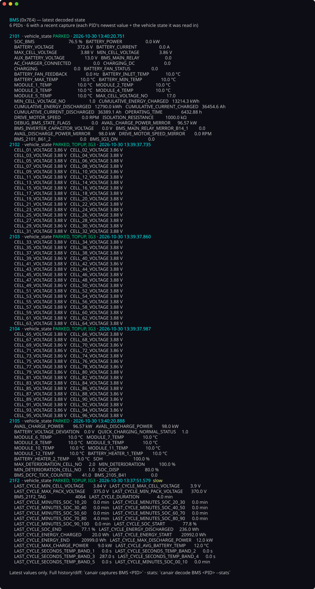

# Read live data

With your [dongle connected](connect-device.md) and `canair status` happy, read
some real data. These examples target the **bundled Ioniq Electric profile**, so the
ECU names (`BMS`, `MCU`, …) are Ioniq-specific — but `discover` works on any car.

First, say which car you have. A profile can describe several
[variants](../concepts/variants.md) of one model (the Ioniq's 28 kWh car and its 38 kWh
facelift), and canair won't talk to a car or record anything until you've named yours:

```bash
canair profile use hyundai-ioniq-ae-ev --variant 28kwh   # once; remembered for this profile
canair variants                                          # what the profile's variants are
```

(`discover` and `identity` work before you've picked, since they're how you find out.)

```bash
# See every ECU responding on the bus (works on any vehicle)
canair discover

# Read the battery ECU's main PID, decoded into named parameters (Ioniq)
canair read BMS:2101

# Read all known parameters for an ECU
canair read BMS

# Read specific named parameters across ECUs
canair read --param SOC_BMS BATTERY_VOLTAGE BATTERY_POWER

# Watch a value live — refreshes, highlights changed bytes and the params they decode
canair monitor BMS:2101

# Read Diagnostic Trouble Codes across every ECU
canair dtc --all
```

`canair read` uses a small [selector syntax](../concepts/query-mini-language.md)
(`ECU:PID`) and can run multi-step pipelines over one session.

Once you've captured some readings, `canair ecu <ECU> pids` shows each PID's
latest decoded value — raw payloads turned into named, unit-bearing parameters:



## Watch it live

`canair monitor` refreshes in place, highlighting the bytes that change and the
parameters they decode. Here it is polling the **battery** with the car in READY
mode — SOC, pack voltage/current, cell voltages, and module temperatures, with
changed values highlighted and the live payload byte-diff underneath:


It monitors several ECUs at once, too. This cross-ECU view watches the
**drivetrain** — the VCU (gear/drive-mode, vehicle state) alongside the MCU
(motor speed/torque, inverter temperatures) — and auto-detects the vehicle state
(`READY`) from the decoded values while recording (`● REC`):


By default each PID refreshes at its own cadence — twice as often as the `period:`
the profile ships for it (what the WiCAN AutoPID profile uses) — so a fast-moving
signal updates briskly while a slow per-cycle record is read only as often as it
changes, and the bus isn't flooded re-reading values that never move. A PID with no
declared period falls back to `--interval` (default 5 s). Press `=`/`-` to poll the
whole set 1.5× faster or slower live (the status line says e.g. `per-PID 1.5× faster`),
and `m` to switch to `--schedule fixed`, which reads *every* PID on every cycle
`--interval` apart — handy when you want an even time-series of one signal for
analysis.

The ECUs are read one after another, so an ECU that stops answering (a body module
that has gone to sleep, say) or answers very slowly holds up everyone else's next
read. The monitor notices and polls that ECU 2×, then 4×, up to 8× less often until it
answers promptly again; its header says `slow (not answering) · polled 4× less often`
and the status line lists it (`slow SKM÷4`). Pass `--no-backoff` to keep hammering it.
A PID whose read failed keeps showing its last value, greyed and marked with how old
it is — `(stale 12s)`.

Not sure what to type? Run `canair monitor` with no arguments on a terminal and
pick from the profile instead: first tick saved groups (the `@` rows, see
`canair groups`) and/or individual ECUs (`space` toggles, `/` filters, `ctrl+a`
selects all or none of the visible ECUs, `ctrl+s` continues), then untick any
PIDs you don't want. A group ticks its member ECUs and pre-selects the PIDs it
names; an ECU ticked on its own starts from its default sweep. The equivalent
command is printed before the monitor starts so you can reuse it. It only reads
the profile, so it works before the device is reachable.

Changed your mind mid-run? Press **`p`** in the running monitor (the header and
status bar both show it) to open the same picker on what is being polled now:
add or drop ECUs and PIDs, then `ctrl+s` twice to apply without restarting;
`escape` or `q` leaves the selection as it was.

## On a different car

`discover` will list *your* car's ECUs, but `BMS:2101` and the other named reads
depend on the active profile's definitions — which, on a fresh profile, are
empty. That's the whole point of the next section:

**→ [Bring your own car](../bring-your-own-car/overview.md)** builds a profile for
your vehicle so these named reads work for *you*.
