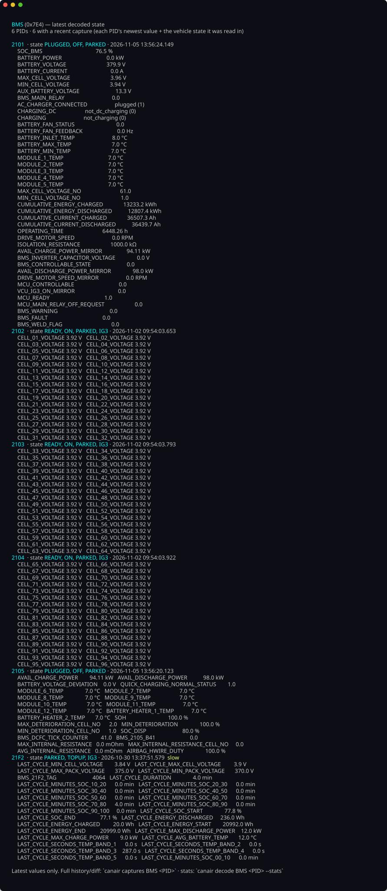

# Read live data

Connect your [dongle](connect-device.md) and check that `canair status` reports it as reachable.
Then read some real data. These examples use the **bundled Ioniq Electric profile**. The ECU names
(`BMS`, `MCU`, …) are specific to the Ioniq. `discover` works on any car.

First, tell canair which car you have. A profile can describe several
[variants](../concepts/variants.md) of one model. The Ioniq profile has a 28 kWh car and a 38 kWh
facelift. canair does not talk to a car or record data until you name your variant:

```bash
canair profile use hyundai-ioniq-ae-ev --variant 28kwh   # once; remembered for this profile
canair variants                                          # what the profile's variants are
```

`discover` and `identity` work before you choose a variant. You use them to find out which car you
have.

```bash
# See every ECU responding on the bus (works on any vehicle)
canair discover

# Read the battery ECU's main PID, decoded into named signals (Ioniq)
canair read BMS:2101

# Read all known signals for an ECU
canair read BMS

# Read specific named signals across ECUs
canair read --param SOC_BMS BATTERY_VOLTAGE BATTERY_POWER

# Watch a value live — refreshes, highlights changed bytes and the signals they decode
canair monitor BMS:2101

# Read Diagnostic Trouble Codes across every ECU
canair dtc --all
```

`canair read` uses a small [selector syntax](../concepts/query-mini-language.md) (`ECU:PID`). It
can run multi-step pipelines in one session.

After you capture some readings, `canair ecu <ECU> pids` shows the latest decoded value of each
PID. It turns raw payloads into named signals with units:



## Watch it live

`canair monitor` refreshes in place. It highlights the bytes that change and the signals that they
decode to. The next screenshot shows `monitor` on the **battery** with the car in READY mode. It
shows SOC, pack voltage and current, cell voltages, and module temperatures. Changed values are
highlighted. The live byte-diff of the payload is below them:


`monitor` can also watch several ECUs at once. The next screenshot shows a cross-ECU view of the
**drivetrain**: the VCU (gear, drive mode, vehicle state) and the MCU (motor speed and torque,
inverter temperatures). While it records (`● REC`), canair detects the vehicle state (`READY`)
from the decoded values:


The monitor colors the payload bytes by what reads them:

- Green: a verified signal.
- Yellow: an unverified signal.
- Grey: nothing reads the byte.
- Muted grey-blue: the declared
  [support map](../concepts/analysis-techniques.md#support-maps-which-bits-are-signals-at-all) of
  the PID (layout bytes, not data).

Press **`?`** for the keys and a color legend.

### How often each PID refreshes

By default, each PID refreshes at its own rate. The rate is twice as often as the `period:` that
the profile gives the PID (the WiCAN AutoPID profile uses the same period). A fast signal updates
quickly. A slow per-cycle record is read only as often as it changes. The bus is not flooded with
reads of values that never move. A PID with no declared period uses `--interval` (default 5 s).

- Press `=` or `-` to poll the whole set 1.5× faster or slower. The status line shows the change,
  for example `per-PID 1.5× faster`.
- Press `m` to switch to `--schedule fixed`. This reads *every* PID in every cycle, `--interval`
  apart. Use it when you want an even time series of one signal for analysis.

### PIDs that stop answering

The monitor reads the ECUs one after another. A PID can stop answering. For example, a body module
went to sleep, or the ECU answers the PID only in another vehicle state. A PID can also answer very
slowly. In both cases, the PID delays the next read of every other PID.

The monitor detects this and polls the slow PID 2×, then 4×, up to 32× less often. It does this
until the PID answers promptly again. The healthy PIDs of the same ECU keep their normal rate.

- The row of the PID says `slow (not answering) · polled 4× less often`.
- The status line lists the PID, for example `slow SKM:22B002÷4`.
- A reconnect restores the normal rate of every PID. The timings of the old link say nothing about
  the new link.
- Pass `--no-backoff` to keep polling the PID at the normal rate.

If a read of a PID fails, the monitor keeps the last value. It greys the value and shows its age,
for example `(stale 12s)`.

### Pick what to monitor

If you do not know what to type, run `canair monitor` with no arguments on a terminal. A picker
opens. The picker only reads the profile, so it works before the device is reachable.

1. Tick saved groups (the `@` rows, see `canair groups`), individual ECUs, or both. `space`
   toggles a row, `/` filters, and `ctrl+a` selects all or none of the visible ECUs. If you tick
   nothing, `enter` takes the highlighted row. To pick one ECU, press `enter`.
2. Press `enter` to continue.
3. Untick the PIDs that you do not want. Press `enter` to start.

A group ticks its member ECUs and pre-selects the PIDs that it names. An ECU that you tick on its
own starts from its default sweep. `escape` clears the filter. A second press steps back. canair
prints the equivalent command before the monitor starts, so you can reuse it.

To change the selection while the monitor runs, press **`p`**. The header and the status bar both
show this key. The same picker opens on the PIDs that canair polls now. Add or remove ECUs and
PIDs, then press `enter` twice to apply the change without a restart. `escape` or `q` keeps the
selection as it was.

## On a different car

`discover` lists the ECUs of *your* car. However, `BMS:2101` and the other named reads depend on the
definitions in the active profile. On a new profile, these definitions are empty. The next section
fills them:

**→ [Bring your own car](../bring-your-own-car/overview.md)** builds a profile for your vehicle.
Then these named reads work for *you*.
