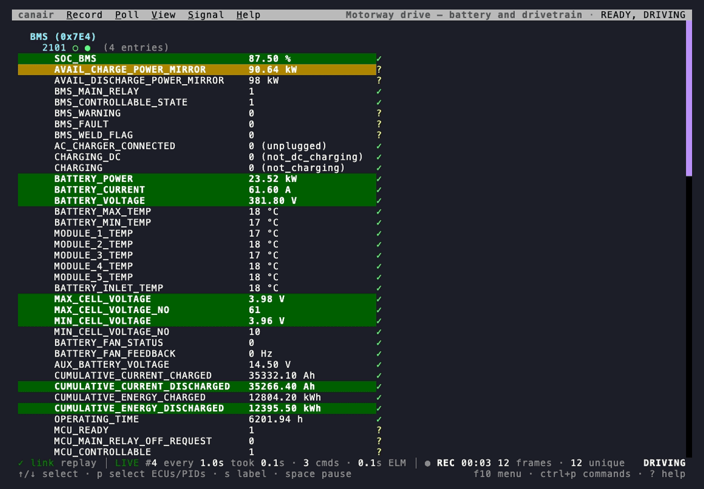
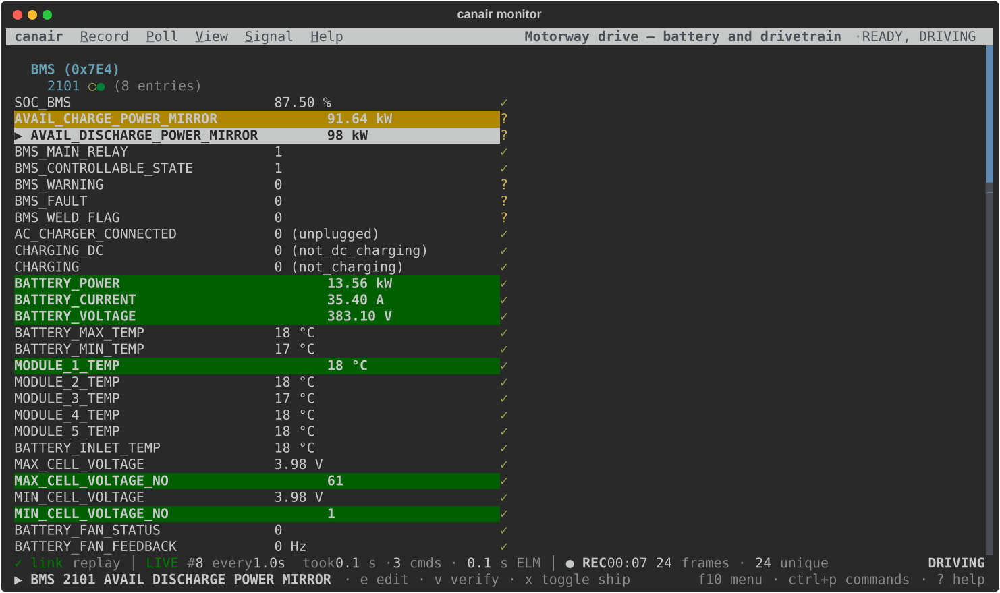
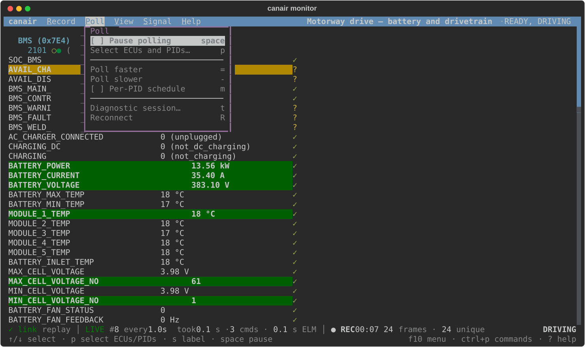
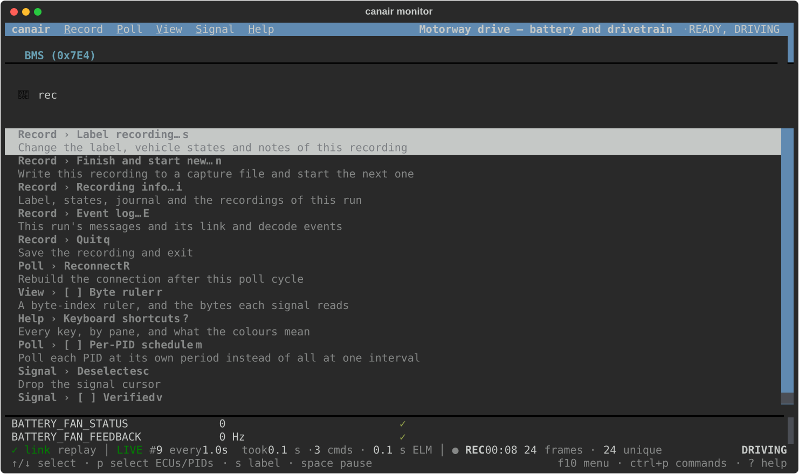
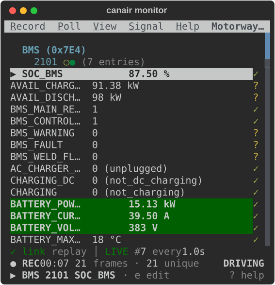

# The monitor

`canair monitor` is canair's main screen. It polls the ECUs you choose and shows their decoded
signals live, in place, while the car drives, charges or sleeps. From the same screen you record
the session, label it, edit and verify signal definitions, open a diagnostic session and, with
`--actuate`, switch outputs. Most work with canair starts here.



The recording above is the real monitor. It replays a motorway drive that the bundled Ioniq
profile recorded on the road, so it needs no car (see
[Documentation screenshots](../development/screenshots.md)). Its status line says `replay` where a
real session names the device and the transport.

## Start it

```bash
canair monitor                          # pick ECUs, then PIDs, from a list (on a terminal)
canair monitor BMS:2101                 # one PID
canair monitor "BMS:2101 VCU:2101 MCU:2102"   # several ECUs at once
canair monitor @charging                # a saved group (see `canair groups`)
canair monitor BMS:2101 --save --label "Motorway drive" --state "READY, DRIVING"   # record it
```

The selectors are the [query mini-language](../concepts/query-mini-language.md) that `canair read`
also takes. `canair monitor --help` lists every flag.

## The screen



From top to bottom:

1. **The menu bar.** It has every command, in the menus Record, Poll, View, Signal, Actuators (with
   `--actuate`) and Help. On its right is the label of the recording, its vehicle states and the
   profile.
2. **The values.** Each ECU, each PID and its decoded signals, with a `✓` for a verified signal and
   a `?` for an unverified one. The values update in place. A refresh never moves the scroll
   position, so the value that you read stays where it is. In the full view, the raw payload is
   below the signals, with each byte colored by what reads it.
3. **The status line.** Four zones, always in the same order. See
   [The status line](#the-status-line).
4. **The bottom line.** The last message, or the selected signal and its keys. On the right are
   the three keys that reach every command: `f10 menu · ctrl+p commands · ? help`.

The colors of the values and the bytes:

- **Green:** a verified signal, or a byte that a verified signal reads.
- **Yellow:** an unverified signal, or a byte that an unverified signal reads.
- **Grey:** a byte that no signal reads.
- **Muted grey-blue:** the declared
  [support map](../concepts/analysis-techniques.md#support-maps-which-bits-are-signals-at-all) of
  the PID (layout bytes, not data).
- **A bright background:** the value or the byte changed in this poll cycle.

Press **`?`** for every key, by pane, and the color legend.

## Find a command

You do not have to learn the keys first. There are three ways to every command:

- **The menu bar.** Press **`f10`** for the first menu, or click a title. With "Option as Meta" (or
  the equivalent) on in your terminal, `alt` and the underlined letter opens one menu. `←` and `→`
  move between menus, `enter` runs an item, `esc` closes the menu. Each item shows its key on the
  right, `[x]` for a setting that is on, and `(•)` for the chosen view or filter. An item that
  cannot run now is greyed out. If you run it anyway, the bottom line says why.

  

- **The command palette.** Press **`ctrl+p`** and type part of a name, for example `rec`, `ruler`
  or `pause`. Each entry shows its menu, its state and its key.

  

- **The keys.** Each menu item shows its key, so you learn the keys as you go. The most used are
  in [Keys you use most](#keys-you-use-most).

## The status line

The status line reports what the monitor does now, in four zones:

| Zone | Shows | Click opens |
|---|---|---|
| **Link** | `✓ link`, or a fault: `⚠ 2 resync`, `✗ 3 drops`, `⟳ RECONNECTING`. The device, the transport, and the round trip when it is slow. | The event log |
| **Poll** | `LIVE` or `PAUSED`, the cycle (`#412`), the schedule, the PIDs that are polled less often, what the last cycle took | The Poll menu |
| **Recording** | `● REC` and how long the recording runs, or `not recording`; the frames captured and how many are unique | Recording info |
| **Car** | An output that is on (`⚠ 1 ON`), the vehicle state that canair detects (`DRIVING`), the open diagnostic sessions (`BMS 81 standard`) | The diagnostic session picker |

Only a problem is highlighted as a colored block: `PAUSED`, `RECONNECTING`, lost frames, or an
output left on. Everything else is plain text, so a colored block always means "look here".

## Messages and the event log

A message replaces the context on the bottom line for a few seconds, with `✓` for a success, `⚠`
for a warning and `✗` for an error. **An error stays until you press a key**, so you do not miss a
failure while you look away. Press **`E`** (or click the link zone) to open the event log. It
lists every message of the run, then the link and decode events of the run.

## Common tasks

### Choose what to poll

If you do not know what to type, run `canair monitor` with no arguments on a terminal. A picker
opens. The picker only reads the profile, so it works before the device is reachable.

1. Tick saved groups (the `@` rows, see `canair groups`), individual ECUs, or both. `space`
   toggles a row, `/` filters, and `ctrl+a` selects all or none of the visible ECUs. If you tick
   nothing, `enter` takes the highlighted row. To pick one ECU, press `enter`.
2. Press `enter` to continue.
3. Untick the PIDs that you do not want. Press `enter` to start.

A group ticks its member ECUs and pre-selects the PIDs that it names. An ECU that you tick on its
own starts from its default sweep. `escape` clears the filter. A second press steps back. canair
prints the equivalent command before the monitor starts, so you can reuse it.

To change the selection while the monitor runs, press **`p`**, or choose **Poll › Select ECUs and
PIDs…**. The same picker opens on the PIDs that canair polls now. Add or remove ECUs and PIDs,
then press `enter` twice to apply the change without a restart. `escape` or `q` keeps the
selection as it was.

### Record a session

Start the monitor with **`--save`** to record every poll as it arrives. canair journals the
recording to disk, so a crash or a lost link does not lose it, and writes it to a capture file
when you quit. Add `--label`, `--state` and `--notes`, or set them later:

- **`s`** (**Record › Label recording…**) changes the label, the vehicle states and the notes of
  the recording, for everything in it.
- **`n`** (**Record › Finish and start new…**) writes the recording now and starts the next one,
  so one run can give several labelled recordings.
- **`i`** (**Record › Recording info…**) shows the recording, where its journal is, and the
  recordings that this run finished.

Without `--save`, `s` writes a one-off snapshot of what the monitor captured so far. Each saved
recording is a capture session: `canair captures uds --sessions` lists them. While canair records,
it [detects the vehicle state](../concepts/vehicle-states.md) from the decoded values.

### Check and edit a signal

Move the cursor over the signals with **`↑`/`↓`**. The bottom line shows the selected signal and
the keys that act on it:

- **`e`** opens the edit dialog: expression, unit, range, notes, verified and ship.
- **`v`** marks the signal verified, or not. **`x`** includes it in the device's AutoPID profile,
  or not.
- **`F`** (or **View › …signals**) shows only the verified, unverified, shipped or not-shipped
  signals.

canair writes the change to the profile with the same editors as `canair pids`, and the next poll
decodes with it. `esc` drops the cursor.

### Change the view

**`V`** (or the **View** menu) steps through four views: the ECUs only, the range each signal took,
the signals, and the signals with their bytes (the default). **`r`** adds a byte-index ruler and
the bytes each signal reads. A view that is not the default shows on the bottom line.

### Control the polling

By default, each PID refreshes at its own rate: twice as often as the `period:` that the profile
gives the PID (the WiCAN AutoPID profile uses the same period). A fast signal updates quickly, and
a slow record is read only as often as it changes. A PID with no declared period uses `--interval`
(default 5 s).

- **`space`** pauses polling. The values hold, and the diagnostic sessions stay open.
- **`=`** and **`-`** poll the whole set 1.5× faster or slower.
- **`m`** switches to `--schedule fixed`. This reads *every* PID in every cycle, `--interval`
  apart. Use it when you want an even time series of one signal for analysis.
- **`t`** opens a diagnostic session type (`10 xx`) on one ECU. The car zone shows each open
  session.
- **`R`** rebuilds the connection after the current cycle.

### PIDs that stop answering

The monitor reads the ECUs one after another. A PID can stop answering. For example, a body module
went to sleep, or the ECU answers the PID only in another vehicle state. A PID can also answer very
slowly. In both cases, the PID delays the next read of every other PID.

The monitor detects this and polls the slow PID 2×, then 4×, up to 32× less often. It does this
until the PID answers promptly again. The healthy PIDs of the same ECU keep their normal rate.

- The row of the PID says `slow (not answering) · polled 4× less often`.
- The poll zone lists the PID, for example `slow SKM:22B002÷4`.
- A reconnect restores the normal rate of every PID.
- Pass `--no-backoff` to keep polling the PID at the normal rate.

If a read of a PID fails, the monitor keeps the last value. It greys the value and shows its age,
for example `(stale 12s)`.

### Switch outputs

With **`--actuate ECU`**, the monitor can switch the IOControl outputs and start the routines of
that ECU while it keeps polling. **`A`** shows the actuator pane and the **Actuators** menu, and
`tab` moves between the values and the pane. Every output that the run switched on shows in the
car zone, and the monitor releases them when it exits. Read [Safety](../concepts/safety.md) first.

## On a phone

The monitor works over SSH from a phone. It is designed for a phone in portrait with the keyboard
up, about 45 columns by 22 rows:



- The menu bar keeps every menu. At 45 columns the titles fit in full. On a narrower screen they
  get shorter (`Rec`, `Sig`), then become one letter each. The recording label has no room on the
  menu bar, so it is in recording info (`i`).
- The status line takes two lines instead of dropping facts.
- Long signal names get shorter (`AVAIL_DISCHA…`), so the value and its mark stay on the line.
- A tap on a menu title or a status zone works like a click, if your SSH client sends taps as
  mouse clicks.

## Keys you use most

| Key | Does |
|---|---|
| `f10` / `ctrl+p` / `?` | Menu bar / command palette / every key |
| `↑` `↓` | Select a signal |
| `e` `v` `x` `F` | Edit / verify / ship / filter the signals |
| `space` | Pause or resume polling |
| `p` | Choose what to poll |
| `=` `-` `m` | Poll faster / slower / switch the schedule |
| `V` `r` | Next view / byte ruler |
| `s` `n` `i` | Label the recording / start the next one / recording info |
| `E` | Event log |
| `t` | Diagnostic session |
| `A` | Actuator pane (with `--actuate`) |
| `q` | Quit (and write the recording) |

`?` in the monitor is the full list, by pane. It is built from the keys themselves, so it is
always current.
