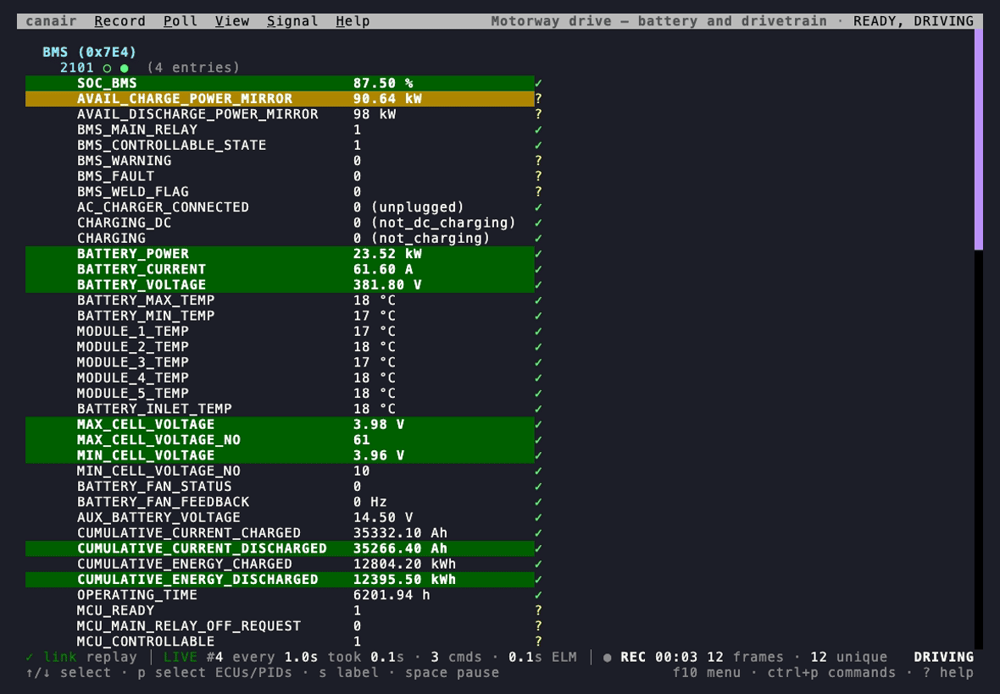
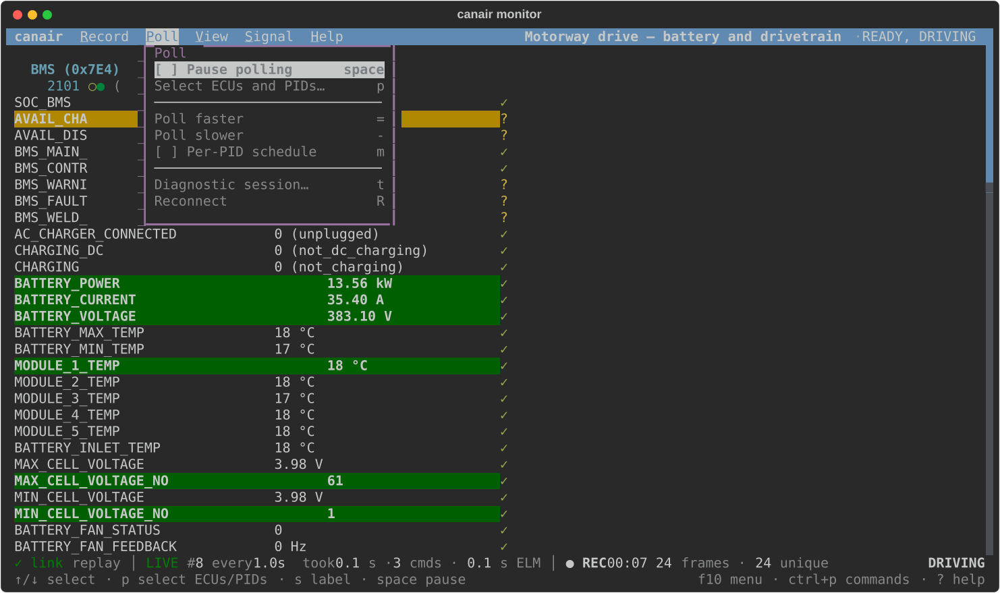
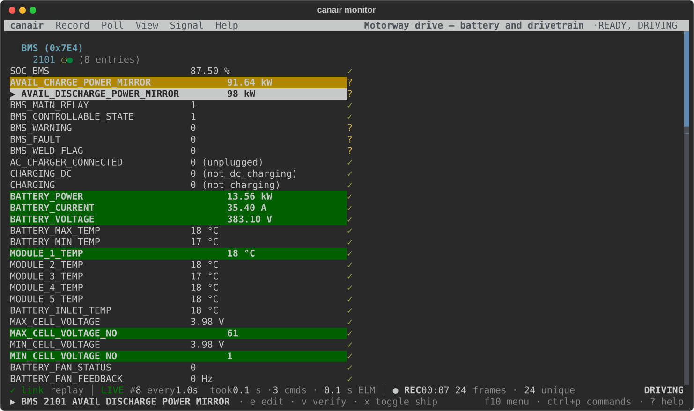
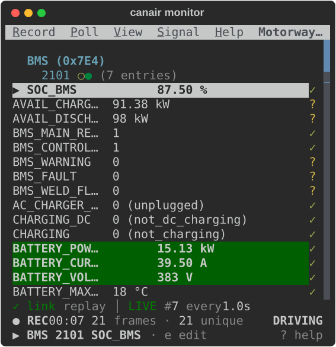

# canair documentation

**CLI for reverse engineering CAN/OBD diagnostics over the air with a WiCAN dongle.**

canair uses a [WiCAN](https://www.meatpi.com/products/wican-pro) WiFi dongle to work with the data
of a vehicle in **two domains**:

- **Diagnostics.** canair sends requests to the electronic control units (ECUs) of the car. It
  uses the UDS (Unified Diagnostic Services) and KWP2000 (Keyword Protocol 2000) protocols.
- **Raw broadcast CAN.** The car sends these Controller Area Network (CAN) frames on its own.
  canair listens passively, or imports frames from external logs and DBC (CAN database) files.

canair helps you capture, decode, correlate and document this data. The result is a
[vehicle profile](concepts/profiles.md) that you can share.

## The monitor: canair's main screen

  
<code>canair monitor</code> polls the ECUs you choose and shows their decoded signals live,
  while the car drives, charges or sleeps. From the same screen you record the session, label it,
  check and edit signal definitions, and open diagnostic sessions. Every command is in its menus
  and its command palette, and it works on a phone over SSH.

  

  
<a class="md-button md-button--primary" href="getting-started/monitor/">Tour the monitor →</a>
  The recording replays a real drive of the bundled Ioniq profile through
  the real monitor.

  

    <a href="getting-started/monitor/#find-a-command">
      
      <strong>Every command in a menu</strong>
      Press f10 or click a title. Each item shows its key and whether it is on, so the menus
        teach the keys.
    </a>
    <a href="getting-started/monitor/#the-status-line">
      
      <strong>A status line that flags problems</strong>
      The link, the polling, the recording and the car, each in its own place. Only a problem
        is highlighted. Click a zone for its detail.
    </a>
    <a href="getting-started/monitor/#on-a-phone">
      
      <strong>Made for a phone, too</strong>
      At 45 columns every menu stays, the status line takes two lines, and long names get
        shorter so values stay on the line.
    </a>
  

## Why canair?

- **Evidence stays with the definition.** Most tools store only the PID, DID and signal
  definitions. canair also stores the captures that support each definition. Anyone can check a
  definition against the data, and the community can decode together. A definition without proof
  has little worth.
- **Two kinds of data in one profile.** canair combines request/response diagnostics (OBD-II,
  UDS, KWP2000) with raw broadcast CAN frames (for example from DBC files). Both kinds use the
  same profile and the same analysis tools. What you know about a signal in one kind of data helps
  you find the same signal in the other.
- **Made for humans and agents.** Helpers import and analyze both kinds of captures. Every
  capability is a subcommand that you can script, with structured output (`--json`). A person or
  an AI coding agent can use it in the same way. The reverse-engineering workflows are available
  as agent skills.
- **Shareable without copied definitions.** Profiles come from captures of real cars. They do not
  copy the definitions of a dealer scan tool. People can share them without copying the content of
  a vendor tool. This opens vehicle maintenance and diagnostics to a wider community.

## See a real car's data, right in your browser

  
The <strong>profile explorer</strong> shows a whole vehicle profile. You can plot what the car
  reported. Click an ECU on the CAN bus map. Put signals from different ECUs on one timeline. The
  explorer shows which signals move together. You do not install or connect anything.

  
<a class="md-button md-button--primary" href="profiles/explorer/">Open the explorer →</a>
  Try it on the 2017 Ioniq: 30 ECUs, 600+ signals and 100+ recorded sessions.

  

    <a href="profiles/explorer/#hyundai-ioniq-ae-ev/BMS">
      
      
      <strong>Browse the buses</strong>
      See which ECU is on which CAN segment. Open an ECU to see its PIDs, signals, actuators
        and research leads. Each one links to its YAML.
    </a>
    <a href="profiles/explorer/#hyundai-ioniq-ae-ev/plot/2026-08-08-e84a15?s=BMS:2101:BATTERY_POWER,ESC:22C101:REAL_SPEED_KMH,BMS:2101:SOC_BMS">
      
      
      <strong>Plot signals from any ECU together</strong>
      One picture shows a drive, a 60 kW fast charge and another drive. It plots battery
        power, speed and state of charge, with the vehicle states above.
    </a>
    <a href="profiles/explorer/#hyundai-ioniq-ae-ev/plot/2026-08-08-e84a15?s=BMS:2101:BATTERY_POWER">
      
      
      <strong>Find what hides in the data</strong>
      One strip shows every signal that moved in a session. Similar signals are side by side.
        Select a signal to see what follows it. Zoom to a moment to see what reacted.
    </a>
  

## Where do I start?

Answer these questions in order. Take the first path that fits.

1. **Do you have a WiCAN dongle and a car with an OBD-II port, and canair is not installed yet?**
   Read [Install](getting-started/install.md). You install canair, connect the dongle and read
   live data from the bundled example car in a few minutes. Then watch it in
   [the monitor](getting-started/monitor.md).
2. **Does something not work?** Read [Troubleshooting](getting-started/troubleshooting.md).
3. **Is your car one of the bundled cars?** Read [Bundled profiles](profiles/index.md). The
   [Ioniq Electric profile](profiles/hyundai-ioniq-ae-ev.md) is the most complete. Each page lists
   the ECUs, decoded signals and IOControl actuators.
4. **Is your car not bundled?** Read [Bring your own car](bring-your-own-car/overview.md). This is
   the main journey. It takes you from an empty profile to decoded, verified signals.
5. **Do you want to share what you decoded?** Read
   [Define & verify](bring-your-own-car/07-define-and-verify.md), then
   [Share your profile](bring-your-own-car/08-share.md). A whole profile, a few decoded signals
   or a fix all help other owners of the same car. See also [Contributing](contributing/index.md).
6. **Do you want to learn from a real hunt?** Read the [case studies](case-studies/index.md). They
   show real investigations from start to end, including the wrong turns. One example is
   [finding the hidden AC input voltage](case-studies/ac-input-voltage.md).

The command list is in the [CLI reference](reference/cli/index.md), and
[Concepts](concepts/architecture.md) explains how canair works.

## What you need

- A **WiCAN dongle**, Pro or classic (non-Pro). Most features work on both. A few are
  [Pro-only](getting-started/connect-device.md).
- A vehicle with an **OBD-II port**.
- [`uv`](https://docs.astral.sh/uv/) to install and run canair.

## A note on safety

Reading data is safe. canair only *reads* unless you tell it to actuate hardware, and every
action that changes state asks for confirmation first. However, **work on the CAN bus of a
vehicle has real risk**. [Safety](concepts/safety.md) explains what canair does and does not do,
and why.
